<div align="center">

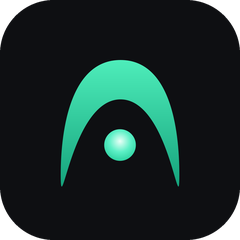

# 증강 연구소 · Augment Lab

**리그 오브 레전드 칼바람 나락(아수라장) 증강·아이템 빌드 시뮬레이터 + 챔피언 티어리스트**

게임에 들어가기 전에 증강 4번과 아이템 6칸을 미리 굴려 보는 iOS 앱

<a href="https://apps.apple.com/kr/app/id6783073993"></a>


<br /><br />

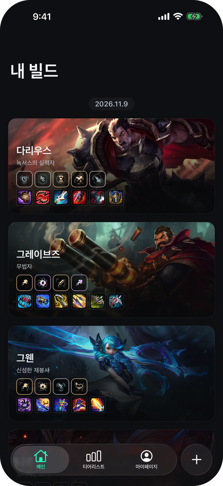
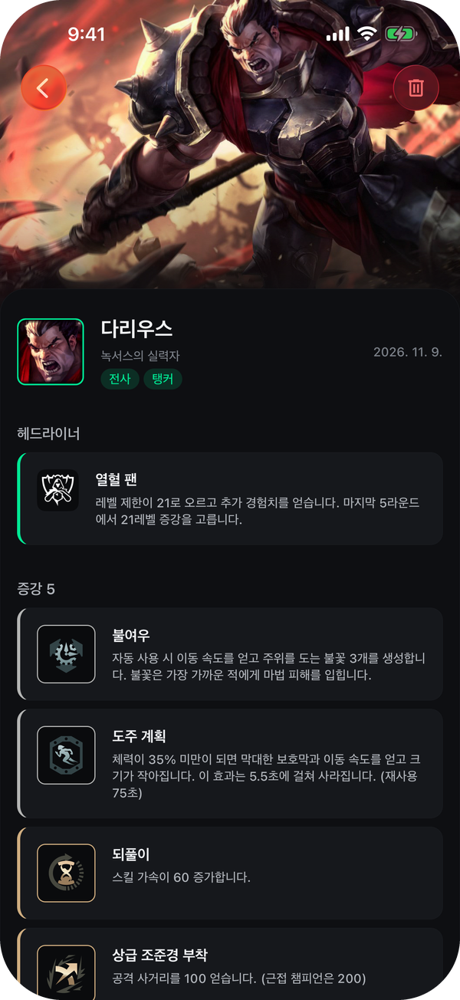
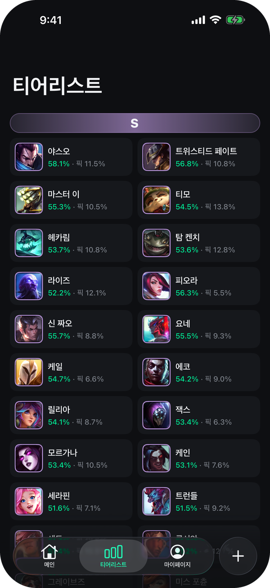
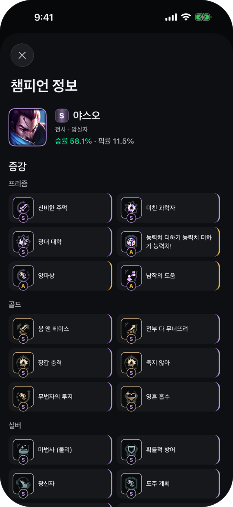

</div>

<br />

## 어떤 앱인가요

**칼바람 나락: 아수라장**은 판마다 증강을 4번 고르고, 무작위로 정해지는 **헤드라이너**가 그 판의 규칙을 바꾸는 모드입니다.
"이 챔피언으로 프리즘 증강이 뜨면 뭘 고르지?", "이 증강엔 어떤 아이템이 맞지?"는 실제로 게임에 들어가야만 알 수 있었습니다.

증강 연구소는 게임과 **같은 확률, 같은 규칙**으로 증강 드래프트를 재현하고, 고른 증강에 아이템을 얹어 **합산 스탯**까지 계산한 뒤 빌드로 저장합니다.
칼바람 통계 기반 **티어리스트**도 함께 있어서, 어떤 챔피언을 하고 어떤 증강을 노릴지 앱 하나에서 정할 수 있습니다.

| 칼바람 증강 | 챔피언 | 칼바람 아이템 | 헤드라이너 | 언어 |
| :---: | :---: | :---: | :---: | :---: |
| **233**개 | **172**명 | **111**개 | **9**종 | 한국어 · English |

<br />

## 주요 기능

### 1. 증강 드래프트 시뮬레이터

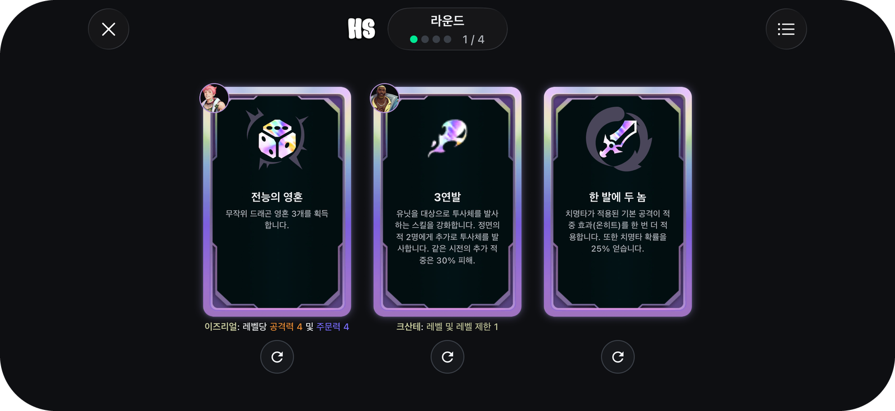

- 라운드마다 실버 30% · 골드 30% · 프리즘 40% 확률로 **등급 하나를 굴리고**, 같은 등급 카드 3장을 보여줍니다. 게임과 같은 방식입니다.
- 카드마다 **리롤 1회**. 전환 증강(골드·프리즘·혼돈), 판도라의 상자처럼 고르면 다른 증강으로 바뀌는 특수 증강도 규칙대로 처리합니다.
- 카드가 뒤집히며 등장하고, 고를 때와 리롤할 때마다 연출이 붙습니다. 지금까지 고른 증강은 오른쪽 **픽 현황 드로어**에서 확인합니다.

### 2. 헤드라이너 9종

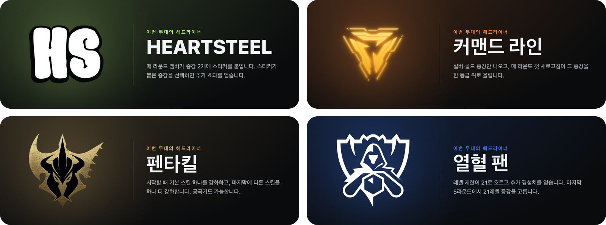

판마다 헤드라이너가 무작위로 정해지고, 등장 연출이 끝나면 그 헤드라이너의 규칙이 드래프트에 그대로 적용됩니다.
규칙은 게임 클라이언트 문자열(`kiwi_goh_*`)을 1차 근거로 옮겼습니다.

<details>
<summary><b>헤드라이너별 드래프트 규칙</b></summary>
<br />

| 헤드라이너 | 드래프트에서 달라지는 점 |
| --- | --- |
| K/DA | 4라운드를 마친 뒤 보너스 증강을 한 번 더 고른다 |
| 펜타킬 | 증강 앞뒤로 Q/W/E/R 스킬 강화 카드를 고른다 (아래 이미지) |
| HEARTSTEEL | 매 라운드 카드 2장에 멤버 스티커가 붙고, 고르면 추가 효과가 쌓인다 |
| 커맨드 라인 | 실버·골드만 나오고, 매 라운드 첫 리롤이 그 카드를 한 등급 올린다. 프리즘은 이 리롤로만 얻는다 |
| 열혈 팬 | 레벨 제한이 21로 오르고, 21레벨 보상으로 증강을 한 번 더 고른다 |
| 디스코 | 결과에 골드 +1,000 |
| True Damage · 귀염둥이 카페 · 꿀벌 | 효과 설명 표시 |

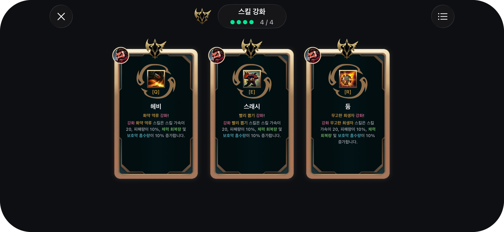

</details>

### 3. 아이템 선택 & 합산 스탯

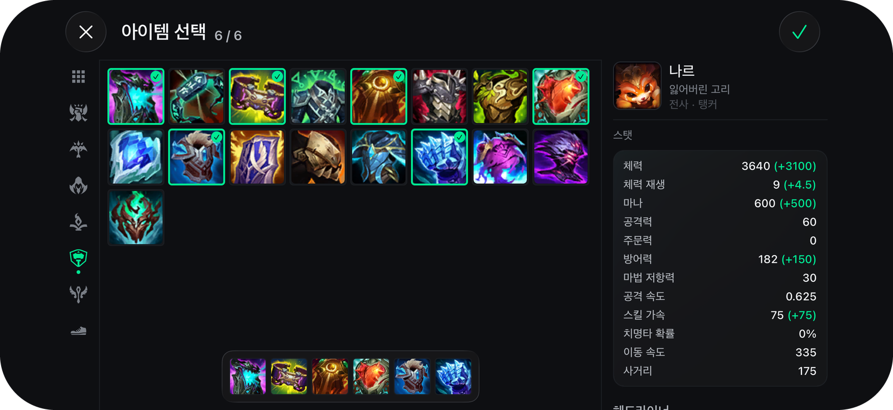

- 칼바람 상점에서 살 수 있는 아이템만 나오고, 전사·원거리딜러·암살자·마법사·탱커·서포터·신발 **역할군 필터**로 골라 6칸을 채웁니다.
- 아이템을 고를 때마다 챔피언 기본 스탯에 아이템 스탯이 **실시간으로 더해지고**, 늘어난 만큼이 `(+3100)`처럼 따로 표시됩니다.

### 4. 커스텀 모드

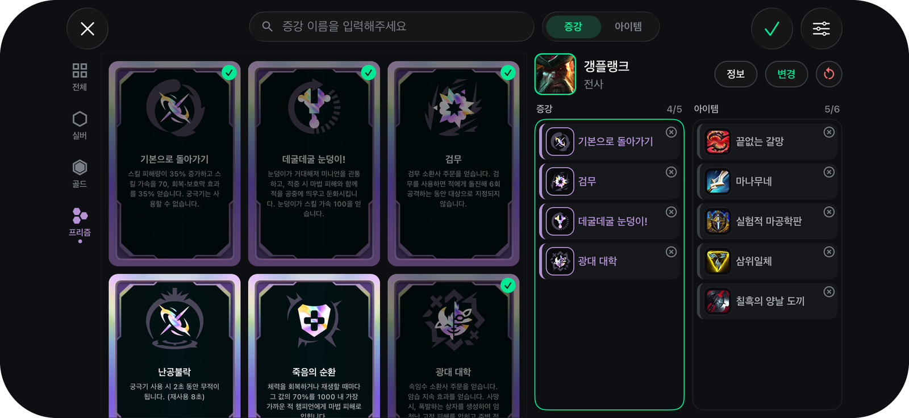

뽑기 없이 전체 증강·아이템 중에서 **길게 눌러 오른쪽 패널로 끌어다 담는** 자유 조합 모드입니다. 등급 필터와 검색을 지원하고, 설정에서 퀵 모드를 켜면 탭 한 번으로 담깁니다.

### 5. 빌드 보관함

<p>
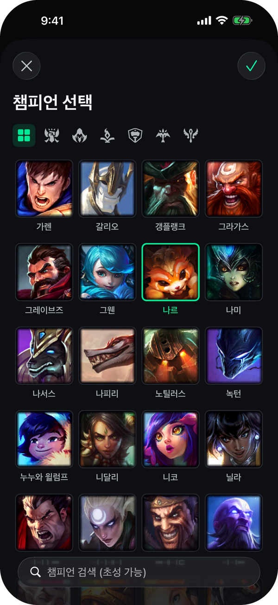
&nbsp;
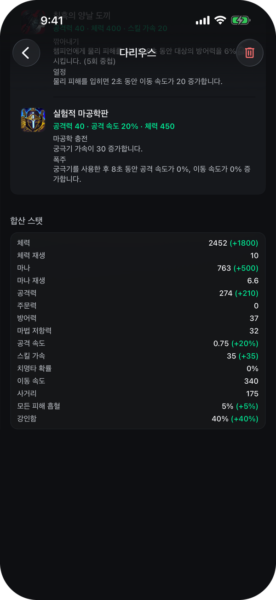
</p>

- 챔피언 선택은 역할군 필터와 네이티브 검색바를 쓰고, **초성 검색**(`ㅇㅅㅇ` → 야스오)도 됩니다.
- 완성한 빌드는 날짜별로 쌓이고, 상세 화면에서 헤드라이너·증강·아이템·합산 스탯을 다시 볼 수 있습니다.
- 상세 화면의 챔피언 배너는 당기면 확대되고, 올리면 패럴랙스로 접힙니다.

### 6. 칼바람 티어리스트

<p>
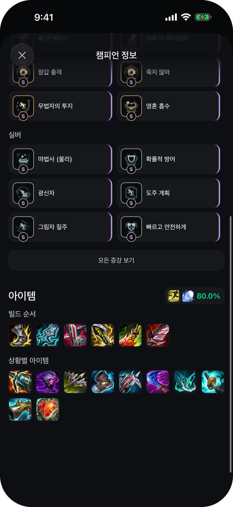
</p>

- 챔피언을 S~D 티어로 나누고 승률·픽률을 함께 보여줍니다. 데이터는 패치마다 갱신합니다.
- 챔피언을 누르면 **희귀도별 추천 증강**(증강마다 S~C 등급), 아이템 빌드 순서, 상황별 아이템, 소환사 주문이 나옵니다.

### 7. 설정 · 백업

<p>
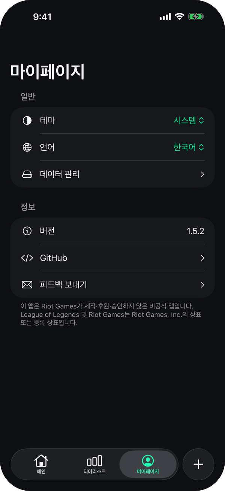
&nbsp;
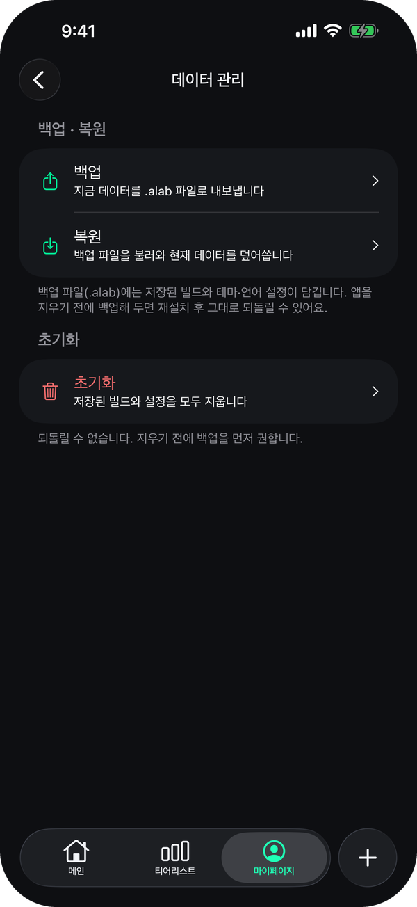
</p>

- 테마(시스템·라이트·다크)와 언어(한국어·English)를 바꿀 수 있습니다. 화면은 iOS 설정 앱과 같은 SwiftUI 리스트로 만들었습니다.
- 계정 없이 기기에만 저장하고, 대신 빌드와 설정을 `.alab` 파일로 **백업·복원**할 수 있습니다.

<br />

## 기술적으로 신경 쓴 점

### 네이티브 UI를 먼저 쓴다
- 설정 화면은 `@expo/ui`의 **SwiftUI `List` · `Section` · `Picker`** 로 만들었고, 헤더·검색바·탭바도 **iOS 네이티브 컴포넌트**입니다. React Native로 흉내 낸 UI는 네이티브로 안 되는 곳에만 씁니다.
- iOS 26에서는 **Liquid Glass** 탭바(`NativeTabs`)와 글래스 버튼(SwiftUI `glassEffect`)을 쓰고, iOS 26 미만에서는 커스텀 탭바와 불투명 버튼으로 바뀝니다 ([`app-tabs.tsx`](src/components/navigation/app-tabs.tsx), [`glass-button.tsx`](src/components/ui/glass-button.tsx)).
- 드래프트·아이템·커스텀 화면은 **가로 고정**이고 나머지는 세로입니다. 화면마다 방향을 잠갔다가 나갈 때 풀어 줍니다 ([`use-landscape-lock.ts`](src/hooks/use-landscape-lock.ts)).
- 색·간격·반경은 모두 [`theme.ts`](src/constants/theme.ts) 토큰에서 가져옵니다. hex 값이나 숫자를 코드에 직접 쓰지 않습니다.

### 게임 규칙은 순수 모듈로 분리하고 스크립트로 검증한다
확률·전환·헤드라이너 규칙은 React에 의존하지 않는 순수 모듈로 분리했습니다. 테스트 러너 대신, 각 모듈을 그대로 import 해서 돌리는 assert 스크립트로 검증합니다.

| 규칙 | 모듈 | 검증 스크립트 |
| --- | --- | --- |
| 등급 확률 (30/30/40) | [`rarity-odds.ts`](src/features/aram/rarity-odds.ts) | `check-rarity-odds.mjs`: 대량으로 굴려 실제 분포를 대조 |
| 전환 증강 · 판도라의 상자 | [`transmute.ts`](src/features/aram/transmute.ts) | `check-transmute.ts` |
| 헤드라이너 9종 | [`rules.ts`](src/features/headliners/rules.ts) | `check-headliners.ts` |
| 빌드 저장 · 백업 형식 | [`build-storage.ts`](src/lib/build-storage.ts) · [`backup-format.ts`](src/lib/backup-format.ts) | `check-build-storage.ts` · `check-backup.ts` |

### 데이터는 빌드할 때 받는다
- 챔피언·아이템은 **Data Dragon**, 증강 아이콘과 ID 매핑은 **CommunityDragon**, 티어리스트는 **aram.gg** 통계를 씁니다.
- 통계 API는 비공식이라 **앱이 실행 중에 호출하지 않습니다.** 빌드할 때만 받아 JSON으로 저장하고, 응답이 반쯤 깨져 있으면 기존 데이터를 덮어쓰지 않도록 sanity 가드를 둡니다 ([`fetch-tierlist.ts`](scripts/fetch-data/fetch-tierlist.ts)).
- 합산 스탯에 쓰는 수치는 아이템 설명의 `<stats>` 태그를 파싱해 만듭니다 ([`parse-item-stats.mjs`](scripts/parse-item-stats.mjs)).
- 데이터를 바꿀 때마다 원본과 앱 데이터를 나란히 비교하는 **검수 페이지**(`docs/index.html`)를 다시 만들어 함께 커밋합니다.

### 첫 실행 경험
- 아이콘은 CDN에서 받아 옵니다. 그래서 처음 설치했을 때 증강·챔피언·아이템 아이콘을 **동시에 12개씩 받아 디스크 캐시에 미리 저장**하고 진행률을 보여줍니다. 이후에는 아이콘이 깜빡이지 않습니다 ([`image-prewarm.ts`](src/lib/image-prewarm.ts)).
- 데이터 버전이 바뀌면 캐시를 다시 채웁니다.

### 구조와 작업 방식
- **feature 단위로 폴더를 나누고 경계 규칙**을 둡니다. 데이터 도메인(증강·챔피언·아이템·헤드라이너)은 어디서든 읽을 수 있지만, 화면 도메인(드래프트·커스텀·빌드·티어리스트)끼리는 서로 참조하지 않습니다.
- 사용자에게 보이는 문구는 화면 파일 안의 `{ ko, en }` 사전으로 언어를 나누고, 키가 없으면 영어를 씁니다.
- React Compiler와 typed routes를 켜 두었고, `useMemo`/`useCallback`을 직접 쓰지 않습니다.
- 기능을 만들기 전에 **계획 문서**([`docs/plans`](docs/plans), 50여 건)를 먼저 쓰고, 동작이 바뀌는 변경은 **시뮬레이터에서 직접 실행해 본 기록**([`docs/verification`](docs/verification))을 남깁니다.

<br />

## 기술 스택

| 영역 | 사용 기술 |
| --- | --- |
| 프레임워크 | Expo SDK 56 · React Native 0.85 (New Architecture) · React 19 · TypeScript 6 |
| 라우팅 | Expo Router (파일 기반 · typed routes · native stack · NativeTabs) |
| 네이티브 UI | `@expo/ui` (SwiftUI) · `expo-glass-effect` · `react-native-screens` |
| 애니메이션 · 제스처 | Reanimated 4 · Worklets · Gesture Handler |
| 이미지 | `expo-image` (디스크 캐시 · 프리페치) |
| 저장 | AsyncStorage · `expo-file-system` + `expo-sharing` (백업 파일) |
| 데이터 | Data Dragon · CommunityDragon · aram.gg (빌드할 때 수집) |
| 배포 | EAS Build · App Store |

<br />

## 프로젝트 구조

```
src/
├── app/                 # Expo Router 라우트 (얇게 유지, screens 를 import 만)
├── features/
│   ├── augments/        # 데이터 도메인: 증강 JSON · 조회 훅 · 타입
│   ├── champions/       #   〃 챔피언 (+ 챔피언 선택 화면)
│   ├── items/           #   〃 아이템 · 스탯 · 필터
│   ├── headliners/      #   〃 헤드라이너 규칙 · 에셋
│   ├── aram/            # 화면 도메인: 증강 드래프트 (확률·전환 규칙)
│   ├── custom/          #   〃 커스텀 모드
│   ├── builds/          #   〃 빌드 목록 · 상세
│   ├── tierlist/        #   〃 티어리스트 · 챔피언 상세
│   └── mypage/          #   〃 설정 · 데이터 관리
├── components/          # 2개 이상 feature 가 쓰는 공용 UI (글래스 버튼, 카드 프레임 …)
├── hooks/               # 전역 훅 (테마 · 로케일 · 화면 방향)
├── lib/                 # 외부 클라이언트 · 순수 유틸 (ddragon · i18n · 초성 · 백업 · 저장소)
└── constants/theme.ts   # 디자인 토큰
scripts/                 # 데이터 수집 · 파싱 · 자체 점검 스크립트
docs/                    # 계획 문서 · 검증 기록 · 데이터 검수 페이지
```

<br />

## 실행

iOS 전용입니다. `@expo/ui`(SwiftUI)와 Liquid Glass를 쓰기 때문에 Expo Go로는 실행할 수 없고, 개발 빌드가 필요합니다.

```bash
npm install
npm run ios      # 개발 빌드 설치 + 시뮬레이터 실행
npm start        # 설치된 개발 빌드에 Metro 만 붙일 때
npm run lint
```

### 데이터 갱신

| 명령 | 하는 일 |
| --- | --- |
| `npm run data:refresh` | DDragon 최신 챔피언·아이템 → `src/features/{champions,items}/data`, `src/lib/version.json` → 아이템 `stats` 재파싱 → 검수 페이지(`docs/index.html`) 재생성 |
| `npm run data:item-stats` | 아이템 설명의 `<stats>` 를 파싱해 `stats` 재생성 (`data:refresh` 가 자동으로 이어 실행) |
| `npm run data:tierlist` | 칼바람 티어리스트 → `src/features/tierlist/data` |

증강 데이터 패치 절차와 검수 페이지는 [`.agents/skills/augment-check/SKILL.md`](.agents/skills/augment-check/SKILL.md) 참고.

### 자체 점검 (테스트 러너 대신 assert 스크립트)

```bash
npx tsx scripts/check-tierlist.ts
npx tsx scripts/check-backup.ts
npx tsx scripts/check-build-storage.ts
npx tsx scripts/check-headliners.ts
npx tsx scripts/check-transmute.ts
node scripts/check-rarity-odds.mjs
node scripts/check-augment-data.mjs
```

구조·코딩 규칙은 [`CLAUDE.md`](CLAUDE.md) 참고.

<br />

---

<sub>증강 연구소는 Riot Games가 제작·후원·승인하지 않은 비공식 앱입니다. League of Legends 및 Riot Games는 Riot Games, Inc.의 상표 또는 등록 상표입니다.</sub>
